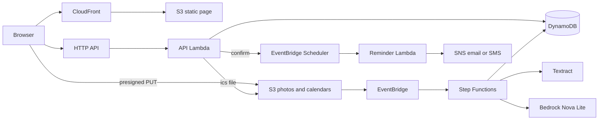

# Rx Reminder

A caregiver keeps prescriptions for several family members. They photograph a prescription, review what was read, review the day-by-day schedule, and only then turn on reminders. Each person has a name and a colour so calendars and reminders are easy to tell apart.

This repository is a hackathon build. The steps below deploy family members, the photo upload, and the reading workflow. After a JPEG or PNG is uploaded, Step Functions runs Textract and Bedrock and stops at `PENDING_REVIEW`. Confirming a reviewed schedule creates reminders and a calendar file. The pages live in `web/index.html`. Paste-ready challenge text is in `docs/submission.md`. The diagram is in `docs/architecture.md`. The video shot list is in `docs/demo-script.md`.

## How it fits together



The services are Lambda, API Gateway, DynamoDB, S3, EventBridge, Step Functions, Textract, Bedrock, EventBridge Scheduler, SNS, and CloudFront. SAM deploys them once. There is no server and no pipeline. The same dose generator feeds the preview, the schedules, and the calendar file.

## Family members and colour-coded calendars

Each person has a name, an optional relationship, and one palette colour. The page shows the colour together with an initial and the name. A colour already in use cannot be picked again. Renaming or recolouring someone does not change a schedule that was already confirmed. That schedule keeps the name and colour from confirm time.

After confirm, download that person's `.ics` file. Apple Calendar and Outlook use the colour stored in the file. Google Calendar ignores colours inside an `.ics` file. Create a calendar named `Meds - {Name}`, set its colour in Google's settings, and import the file into that calendar. Every event title still starts with the colour emoji and the person's name.

## Safety

- OCR and the model can be wrong. Nothing is scheduled until a person reviews the medicines and then reviews the generated schedule for the named patient.
- The model must return null instead of guessing.
- This is a reminder aid, not medical advice.
- The patient's name is typed by the caregiver. It is never sent to Textract or Bedrock, and it is not written to CloudWatch.
- Reminders go to the email or phone entered at confirm time. That may be the caregiver, not the patient.

## Demo auth

Send the deploy-time API key in the `X-Api-Key` header. The user id is the first 12 hex characters of SHA-256 of that key, so one key is one user. This is a demo shortcut. A production version would use Amazon Cognito.

## Deploy

Use a region where Amazon Textract and your Bedrock model are available. The default is `us-east-1`. Dose time zones do not depend on the region. The default zone is `Africa/Nairobi`.

The default Bedrock model id is `us.amazon.nova-lite-v1:0`. In the Bedrock console, open Model access and enable that model in `us-east-1` before uploading a photo. If it is not available, pass a model that is enabled, for example a Claude Haiku id, as `BedrockModelId`. Leave Bedrock invocation logging off so OCR text is not copied into CloudWatch. The workflow itself logs only error events, without the execution data.

```bash
aws sts get-caller-identity
sam build
sam deploy --guided --parameter-overrides \
  ApiKey='replace-with-16-plus-chars' \
  StageName=prod \
  DefaultTimezone=Africa/Nairobi \
  BedrockModelId=us.amazon.nova-lite-v1:0
```

`--guided` asks you to confirm the stack name (`rx-reminder`), region (`us-east-1`), and the changeset. `ApiKey` must be at least 16 characters. Do not commit the key. If the prompt offers to save parameters, decline, or the key will be written into `samconfig.toml`.

Confirm the changeset. When it finishes, copy `ApiUrl` from the outputs.

Idle cost is effectively zero. DynamoDB is on-demand, Lambda runs only when called, and the HTTP API has no hourly charge.

Photos must be JPEG or PNG and at most 10 MB (the Textract sync limit). The upload URL expires after 5 minutes and is signed for one `Content-Type`. Send that exact header on the PUT.

## Try the phase 1 API

```bash
export API_URL="https://YOUR_API_ID.execute-api.us-east-1.amazonaws.com/prod"
export API_KEY="your-key-at-least-16-chars"

curl -s -X POST "$API_URL/patients" \
  -H "content-type: application/json" \
  -H "x-api-key: $API_KEY" \
  -d '{"name":"Amina","relationship":"Daughter"}'

curl -s "$API_URL/patients" -H "x-api-key: $API_KEY"

curl -s -X POST "$API_URL/prescriptions" \
  -H "content-type: application/json" \
  -H "x-api-key: $API_KEY" \
  -d '{"patientId":"PATIENT_ID_FROM_ABOVE","contentType":"image/jpeg"}'
```

A missing or wrong key returns `401` and `{"error":"Unauthorized"}`. Creating a prescription without a real `patientId` returns `404`.

Put the photo with the URL and headers from the create response (the header must match exactly):

```bash
curl -s -D - -o /dev/null -X PUT "$UPLOAD_URL" \
  -H "Content-Type: image/jpeg" \
  --data-binary @photo.jpg
```

A successful PUT returns `200` and an `ETag`. The object key is `uploads/{userId}/{prescriptionId}.jpg` or `.png`. That PUT emits an S3 event, and the state machine moves the record to `PROCESSING`, then `PENDING_REVIEW` or `FAILED`.

Poll until the status leaves `UPLOADING` (give it up to a minute or two):

```bash
curl -s "$API_URL/prescriptions/PRESCRIPTION_ID" -H "x-api-key: $API_KEY"
```

A readable prescription returns `PENDING_REVIEW` and `extracted.medications`. Null fields were not guessed. A blurry photo returns `FAILED` with `We couldn't read that image clearly. Try a sharper, well-lit photo.` A picture that is not a prescription returns `That doesn't look like a prescription or medicine label.` If the model is not enabled, `failureReason` says to enable the Bedrock model or change `BedrockModelId`.

In the Step Functions console, open the state machine `rx-process-rx-reminder` to see the graph and each run. `events/sample_eventbridge_s3.json` is a sample input for a console test; replace the bucket name and the key with a real upload before starting it. OCR text is not stored in DynamoDB.

A patient cannot be deleted while they have an active prescription. Renaming or recolouring a patient does not change schedules that already exist (those keep a snapshot taken at confirm time).

## Preview and confirm

Preview does not create reminders. Send the medicines and the day settings. Copy `scheduleHash` from the response into confirm. If the hash does not match, confirm returns `409` and `The schedule changed, please review it again`.

```bash
curl -s -X POST "$API_URL/prescriptions/PRESCRIPTION_ID/preview" \
  -H "content-type: application/json" \
  -H "x-api-key: $API_KEY" \
  -d '{"medications":[{"name":"Amoxicillin","dose_amount":1,"dose_unit":"capsule","times_per_day":3,"duration_days":5}],"settings":{"timezone":"Africa/Nairobi","startDateTime":"2026-11-17T08:00:00","wakeTime":"07:00","sleepTime":"22:00"}}'

curl -s -X POST "$API_URL/prescriptions/PRESCRIPTION_ID/confirm" \
  -H "content-type: application/json" \
  -H "x-api-key: $API_KEY" \
  -d '{"acknowledged":true,"scheduleHash":"HASH_FROM_PREVIEW","medications":[{"name":"Amoxicillin","dose_amount":1,"dose_unit":"capsule","times_per_day":3,"duration_days":5}],"settings":{"timezone":"Africa/Nairobi","startDateTime":"2026-11-17T08:00:00","wakeTime":"07:00","sleepTime":"22:00","channel":"email","destination":"you@example.com"}}'
```

Email reminders need the AWS subscription message confirmed in the inbox. Confirm also returns `icsUrl`, a one-hour download link for that patient's calendar file. A fresh link is available while the schedule is active:

```bash
curl -s "$API_URL/prescriptions/PRESCRIPTION_ID/calendar" -H "x-api-key: $API_KEY"
```

Apple Calendar and Outlook use the colour stored in the file. Google Calendar ignores colours inside an `.ics` file. Import each person into their own calendar, for example one named `Meds - Amina`, and set that calendar's colour in Google's settings. Every event title still starts with the colour emoji and the person's name.

Cancel removes the dose schedules and marks the prescription `CANCELLED`. Repeating it is safe:

```bash
curl -s -X DELETE "$API_URL/prescriptions/PRESCRIPTION_ID" -H "x-api-key: $API_KEY"
```

A confirmed prescription can send up to five test reminders:

```bash
curl -s -X POST "$API_URL/prescriptions/PRESCRIPTION_ID/test-reminder" \
  -H "x-api-key: $API_KEY"
```

## Web page

The hosted page is https://d1l0axp05yrolu.cloudfront.net/

The same file still opens locally. From this folder, run `python3 -m http.server` and open `http://127.0.0.1:8000/web/index.html`. Under Setup, enter the API URL and the demo key. The page keeps those in this browser only.

The page has the family list, a new photo, medicine review, the generated schedule, calendar download, and the prescription list. Google Calendar still ignores colours stored in the file; the page explains how to give each person their own calendar.

## Tests

Unit tests do not call AWS:

```bash
PYTHONPATH=src .venv/bin/python -m pytest -q
```

`scripts/smoke_test.sh` runs the live path: create, upload, poll, confirm, one test reminder, then the calendar. It reads `API_URL`, `API_KEY`, and `DESTINATION` from the environment. Put your own JPEG at `tests/fixtures/sample_prescription.jpg` first. Confirm creates real schedules.

## Design decisions

A person reviews the medicines, then reviews the timetable, before any reminder exists. Scheduling is deterministic so the preview and the calendar cannot disagree. The patient's name is typed by the caregiver and is kept out of Textract, Bedrock, and CloudWatch. The model is instructed to return null rather than invent a dose.

## Known limitations

Google Calendar ignores `.ics` colours. Email reminders wait until the caregiver clicks the AWS subscription link. SMS on a new account stays in the SNS sandbox until the number is verified. The demo login is one shared API key, not an account per person. The app does not check drug interactions or record whether a dose was taken.

## Future work

Amazon Cognito instead of the shared key. Prescriptions written in Swahili or another language. A record of doses taken. Telegram or WhatsApp as a channel. A notice to the caregiver when a course is about to end.

## Layout

`template.yaml` is the stack. `src/api.py` is the router. `web/index.html` is the page. `src/extract_text.py`, `src/structure.py`, and `src/save_result.py` are the workflow steps. `statemachine/process_prescription.asl.json` is the state machine. All Lambdas share `CodeUri: src/` so `common` imports work without a layer.
