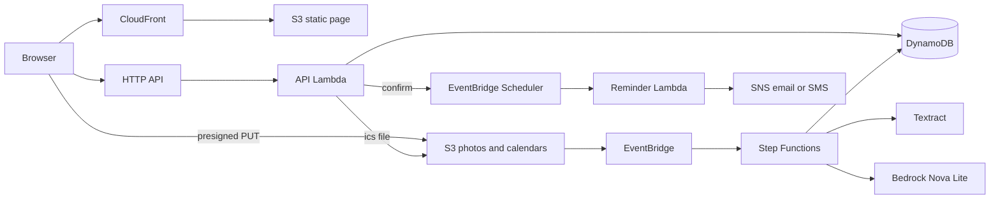

# Architecture

Rx Reminder turns a prescription photo into named reminders only after a person checks the medicines and the generated timetable.

## What each service does

| Service | Role |
|---|---|
| CloudFront | HTTPS for the single static page. No custom domain. |
| S3 | One private bucket for the page. One private bucket for photos and `.ics` files. |
| API Gateway HTTP API | Routes for family members and prescriptions. |
| Lambda | API router, Textract step, Bedrock step, save step, and the reminder sender. |
| DynamoDB | On-demand single table. One item per person and one per prescription. |
| EventBridge | Starts the workflow when a photo object is created. |
| Step Functions | PROCESSING, Textract, Bedrock, PENDING_REVIEW or FAILED. It never creates reminders. |
| Textract | Sync text detection for a JPEG or PNG. |
| Bedrock | Nova Lite returns medicine JSON. Missing values stay null. |
| EventBridge Scheduler | One schedule per medicine per daily clock time, in the patient's timezone. |
| SNS | One email topic per caregiver address, or a transactional SMS. |
| CloudWatch Logs | Errors only. Patient names and OCR text are not logged. |

AWS SAM defines the stack. `sam deploy` publishes it. There is no pipeline, server, container, or VPC.

## Request flow

1. The browser loads `web/index.html` from CloudFront.
2. Setup stores the API URL and demo key in the browser. The key's SHA-256 prefix is the household id.
3. Family members are created through the HTTP API and stored in DynamoDB with a palette colour.
4. A new prescription requires a `patientId`. The API writes `UPLOADING` and returns a presigned PUT. The browser uploads the JPEG directly to S3.
5. EventBridge starts Step Functions. The state machine sets `PROCESSING`, runs Textract, asks Bedrock to structure the text, and saves `PENDING_REVIEW` or `FAILED`. The patient's name is not part of that request. Raw OCR text is not stored.
6. The page polls `GET /prescriptions/{id}` and shows editable medicine cards.
7. `POST /preview` builds the dose list with fixed rules and returns `scheduleHash`. It writes nothing.
8. `POST /confirm` accepts the schedule only when the hash matches and the caller sets `acknowledged` to true. It then creates Scheduler entries, an SNS subscription, and the calendar file, and sets the prescription to `ACTIVE`.
9. Scheduler invokes the reminder Lambda at each local dose time. The message names the patient.
10. `DELETE /prescriptions/{id}` deletes that prescription's schedules and marks it `CANCELLED`.

Preview, Scheduler, and the `.ics` file all call the same dose generator, so the timetable and the calendar cannot drift apart.
