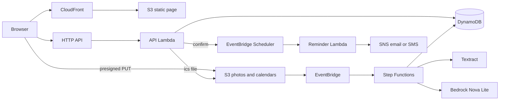

# Submission text

Paste the sections below into the challenge form. Record the video from `docs/demo-script.md`, upload it publicly, and replace the video placeholder.

## The problem and what the build does

A caregiver often holds prescriptions for more than one person. Paper labels are easy to mix up, and a reminder that does not say who it is for is easy to give to the wrong person.

Rx Reminder is a serverless aid for that household. The caregiver adds each person by name and colour, photographs a prescription or label, and checks the medicines the system read. They then check a day-by-day timetable and explicitly confirm it for that named person. Only then does the app create reminders and a calendar file in that person's colour.

Nothing is scheduled before that confirmation. The model returns null instead of guessing a dose. The patient's name is typed by the caregiver. It is never sent to Textract or Bedrock. The product is a reminder aid, not medical advice.

Live page: https://d1l0axp05yrolu.cloudfront.net/

## Serverless services and how they connect

The browser loads the static page from CloudFront, which reads a private S3 bucket. The page calls an Amazon API Gateway HTTP API. One Lambda checks the demo API key, stores family members and prescriptions in on-demand DynamoDB, and returns a presigned URL. The browser uploads the photo straight to a second private S3 bucket.

That upload emits an EventBridge event, which starts a Step Functions workflow. The workflow marks the prescription PROCESSING, calls Textract, sends the text to Amazon Bedrock (Nova Lite) for structured medicines, and saves PENDING_REVIEW. Raw OCR text is not written to DynamoDB.

The caregiver edits the medicines and previews the timetable. Preview is a pure calculation and creates no reminders. Confirm checks a hash of the timetable the person just saw. On a match, the API Lambda creates EventBridge Scheduler entries, one per medicine per daily time, writes an `.ics` file to S3, and subscribes an SNS email topic for the caregiver address. When a dose is due, Scheduler invokes a second Lambda, which publishes the reminder through SNS. The message names the patient.

There is no server to run, no container, no VPC, and no deployment pipeline. The stack is defined once with AWS SAM and deployed with `sam deploy`.

## No servers to manage

Every runtime piece is serverless and scales to zero: Lambda, HTTP API, on-demand DynamoDB, S3, EventBridge, Step Functions, Textract, Bedrock, EventBridge Scheduler, SNS, and CloudFront. Idle cost is request pricing only. There is no EC2 instance, container service, database server, or CI/CD pipeline.

## Demo

Video link: PASTE_PUBLIC_VIDEO_URL

The video is under 3 minutes and shows the page running end to end: choose a family member, upload a photo, review medicines, review and confirm the schedule, show the Scheduler entries and the calendar file, and send a test reminder that names the patient. Shot list: `docs/demo-script.md`.
